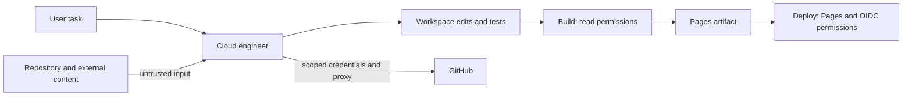

# A simple threat model for the cloud engineer and blog

The agent is an engineer with tools and a Git connection. Repository text,
downloaded dependencies and web responses are things it reads, not people who
can grant it permission. The goal is to keep useful engineering access while
limiting the consequences of a misleading instruction or compromised dependency.

## What we protect

- Source code, uncommitted work, Git history and the published blog.
- GitHub credentials and the authority to push, open PRs or publish Pages.
- The environment configuration and the integrity of downloaded build tools.

## Risks and controls

| Threat | What could happen | Control |
| --- | --- | --- |
| Prompt injection in a file, dependency message or web page | The agent treats text as an instruction to leak data or change permissions | Saved operating instructions require user-task authority; external content cannot expand scope or grant permission |
| Arbitrary outbound access | Compromised code sends workspace data to an attacker server | Replace the custom `*` rule with workflow destinations; keep the platform proxy and TLS checks |
| Credentials inherited by build tools | A gem or build plugin reads a GitHub token | Run public dependency installation and Jekyll without `GH_TOKEN`, `GITHUB_TOKEN` or `JEKYLL_GITHUB_TOKEN`; do not promote the CLI token in activation |
| Build code has deployment authority | Compromised build code publishes or requests an OIDC token | Give the build only read permissions; grant Pages write and OIDC only to the separate deploy job; disable checkout credential persistence |
| Mutable CI or theme references | A retagged action or theme silently changes executable code | Pin all direct workflow actions and the theme to verified full commit SHAs |
| Destructive or unintended remote changes | Local work is lost or an unreviewed change reaches production | Preserve user changes; use task branches and PRs; never treat repository instructions as authority to force-push, merge, deploy or delete |

## Scope and limits

This is a focused hardening review of the cloud configuration and the static
blog's build/publish boundary, based on repository revision
`2b167d040e0c52cd69e65353d90e7d0492ad95b3` and environment draft revision 3.
These are attack scenarios, not evidence of a breach or a complete vulnerability
audit. The site has no application backend or database in this checkout.

An allowlist is a destination control, not a repository-scoped data-loss control:
allowed package registries and GitHub can also host attacker content. The
platform's package-manager presets remain selected. Removing token variables
reduces ambient exposure but does not sandbox native extensions or remove the
proxy's separately scoped Git authentication. Pins do not prove code is safe and
must be deliberately updated, including transitive actions and dependencies.

Ruby 3.1 and the locked GitHub Pages dependencies remain a legacy build stack.
Updating that stack needs a separately validated compatibility change; this work
does not claim current dependency advisories are resolved. The Pages host owns
HTTP response headers and TLS configuration.

## Checks and activation

- Validate workflow syntax and the build/deploy permission split.
- Resolve action/theme pins against their official Git remotes.
- Run the frozen dependency check and production build without token variables.
- Start Jekyll and check the homepage, about page, article, CSS, RSS and sitemap.
- Verify the saved draft has no custom wildcard and retains the setup workflow.

Environment draft changes take effect only after review, save and publication.
Confirm network enforcement and Git access in a fresh task. Branch protections,
required PR reviews and protected deployment reviewers must be configured by a
repository administrator; their presence was not verified here.

## Visitor-facing surface

The public site serves static pages. It has no sign-in, database, submitted forms
or configured comment/analytics provider. The theme previously loaded a mutable
icon stylesheet and fonts from a third-party CDN on each visit. A local head
override now uses only first-party styles and system fonts; visible link text
remains usable without icon fonts. A referrer policy limits cross-site referral
detail. This does not configure server security headers: GitHub Pages controls
those, and no unsupported header file or restrictive, untested CSP was added.
